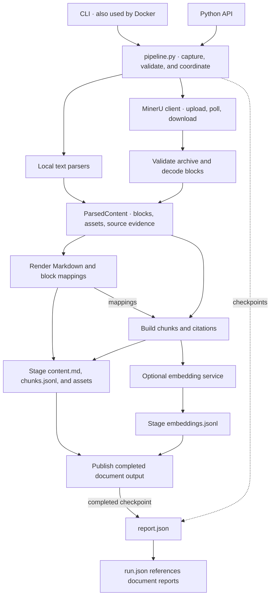

# Architecture

Multimodal Doc Pipeline turns files into readable Markdown and retrieval chunks with source citations. Optional embeddings let downstream systems index those chunks. The pipeline writes files to disk. It does not run a search service or manage a vector database.

This page explains how the implementation fits together. [Output format](output-format.md) defines the exported data. Installation and usage are in the [README](../README.md).

## One pipeline, two parsing paths

The CLI calls the same `process_file` and `process_files` functions that Python callers use. Docker packages the CLI without adding a separate processing path.

Text formats are parsed locally. PDF, Office, and image files are uploaded to MinerU. Both paths produce `ParsedContent`, so rendering and chunking do not depend on the input format or the provider's response schema.

The coordinator captures inputs temporarily, records execution, and publishes the completed document output. Blocks, detailed selections, and provider archives stay in the processing workspace. `embeddings.jsonl` is created even when embedding is disabled, in which case it is empty.

## Structured blocks preserve meaning and evidence

[`ParsedContent`](../src/doc_pipeline/contracts/document.py) contains ordered `Block` objects, inline asset references, a parse status, and diagnostics. Each block has a typed payload, such as a heading, text, table, code, equation, or image. Source locations belong to the block rather than to its rendered text.

This shared model separates three representations with different purposes.

- The original file supplies source evidence and a SHA-256 digest.
- `content.md` supplies a readable rendering. Tables may remain HTML, and unsupported syntax may appear in fenced blocks.
- Chunks supply text for retrieval. Their text need not be a substring of the rendered Markdown.

The renderer returns both Markdown and `MarkdownMapping` records. The chunker uses those mappings and block selections to connect each chunk to the rendered document and the original source. It does not parse the Markdown again to recover citations.

Unsupported content becomes `Opaque` where the parser can preserve it. Nonempty opaque content remains in the output and produces chunks without embedding input. The report records content interpretation and source location coverage in separate distributions.

## Chunking follows document structure

The [chunk builder](../src/doc_pipeline/chunking/builder.py) tracks headings and packs prose into chunks. It uses sentence and line boundaries where possible. Oversized tables can split by row groups, and oversized code can split by lines. Slide boundaries reset the heading context.

`body` holds the selected content. `embedding_input` can add headings, captions, table headers, or footnotes so a retrieved fragment retains context. Internal selections distinguish body text from added context and headings. Exported citations describe the body.

Size budgets count UTF-8 bytes in the embedding input, not tokens. The target guides packing. The maximum is checked before embedding, but it is not a guarantee that every exported chunk fits. An indivisible element can remain oversized and receive an `input_too_large` embedding error.

## Citations require evidence from the original file

Local parsers track character ranges in the decoded source. When parsing changes the text, the citation can identify an enclosing source region instead of an exact character match.

For remote documents, the PDF evidence matcher checks provider content against layout data and PDF page geometry. Original positions also require verified page correspondence or Office positions. The chunk exporter uses body selections to project those positions. Provider coordinates remain internal to parsing and are not exported as original positions. [PDF evidence](../src/doc_pipeline/parsers/multimodal/pdf_evidence.py) · [Chunk citations](../src/doc_pipeline/chunking/citations.py)

Parsing completeness and citation precision therefore answer different questions. A document can parse completely while its original source locations remain unavailable.

## Execution and failure boundaries

[`pipeline.py`](../src/doc_pipeline/pipeline.py) validates inputs, selects parsers, renders content, builds chunks, writes outputs, and optionally requests embeddings. It records per-stage timings and counts throughout that work.

[`contracts/observations.py`](../src/doc_pipeline/contracts/observations.py) defines shared service observations, request counts, and embedding token usage. [`contracts/run.py`](../src/doc_pipeline/contracts/run.py) owns execution states, stage timing, grouped issues, and report snapshots. The pipeline maps parser diagnostics to output locations and derives result counts from the published payloads. The CLI derives its display status and exit code from the report.

For batches, local documents run in a thread pool controlled by `local_workers`. Remote documents are submitted in groups controlled by `mineru.batch_size`. Local work can overlap remote acquisition. The final `run.json` preserves input order regardless of completion order.

Caught failures belong to individual files, so one failed document does not stop the remaining batch. Embedding issues identify affected chunks and leave parsed content available. A successful embedding response with missing vectors or repeated input indices triggers one resend of the same batch. If that resend fails, processing continues with the next batch. The Python single-file API raises fatal processing errors. The batch API records caught file errors in each document report. If a report is unavailable, the corresponding `run.json` entry carries the failure.

Each run requires an empty or nonexistent output directory. After locking the directory, the pipeline writes report checkpoints and prepares document files in private staging. It installs the document files before changing `report.json` to `completed`. Caught failures discard the staged files and update the report. If installation has started, the pipeline rolls back the files it installed. The batch also checkpoints `run.json` and marks it `interrupted` on a caught interruption.

## Where responsibilities live

The source is grouped around the shared document model and the steps that consume it.

- [`cli.py`](../src/doc_pipeline/cli.py) handles arguments, JSON on stdout, and exit codes. [`pipeline.py`](../src/doc_pipeline/pipeline.py) coordinates processing for both public APIs.
- [`contracts/`](../src/doc_pipeline/contracts/) defines configuration, document blocks, chunks, citations, and execution records.
- [`parsers/text/`](../src/doc_pipeline/parsers/text/) handles local syntax and assets. [`parsers/multimodal/`](../src/doc_pipeline/parsers/multimodal/) handles MinerU requests, archive validation, block decoding, and PDF evidence.
- [`parsed_content/`](../src/doc_pipeline/parsed_content/) defines block text selection and Markdown rendering. [`chunking/`](../src/doc_pipeline/chunking/) builds retrieval chunks and exports citations and metadata.
- [`services/`](../src/doc_pipeline/services/) handles embeddings, HTTP helpers, file serialization, and filesystem operations.

Parser changes meet the rest of the system at `ParsedContent`. Output changes meet downstream consumers at the [serialized contract](output-format.md), including its range and precision rules.
